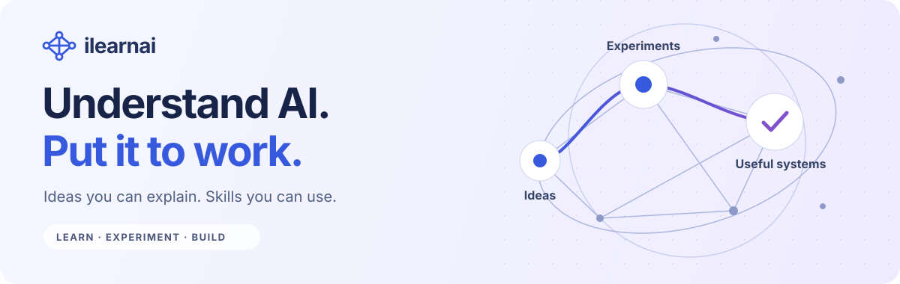
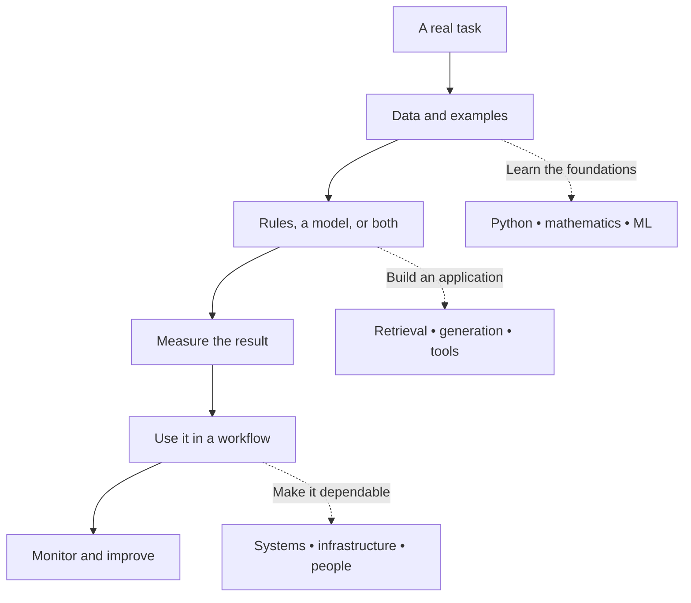

<p align="center">
  
</p>

# ilearnai · The AI learning hub

Learn how AI works, where it helps, and how to build something useful with it. Start with plain-language explanations, follow a learning path, and test your understanding through diagrams, worked examples, and small Python experiments.

This repository brings together **11 learning tracks, 63 chapters, 245 lessons, and 11 interactive labs**. Read the guides here on GitHub; run the companion learning portal for narrated animations, chapter videos, quizzes, coding activities, and progress tracking.

**[Start learning](docs/learning-paths.md)** · **[AI explained](docs/ai-primer.md)** · **[AI at work](docs/ai-at-work.md)** · **[Build a project](#worked-projects)** · **[Run the portal](docs/development.md)**

## Contents

- [Choose your starting point](#choose-your-starting-point)
- [How the ideas connect](#how-the-ideas-connect)
- [The curriculum](#the-curriculum)
- [Learn one idea at a time](#learn-one-idea-at-a-time)
- [Worked projects](#worked-projects)
- [Try the code](#try-the-code)
- [Explore the interactive labs](#explore-the-interactive-labs)
- [Study plans](#study-plans)
- [Papers, tools, and further learning](#papers-tools-and-further-learning)
- [Contribute](#contribute)
- [Credits](#credits)

## Choose your starting point

You do not need to be a programmer to begin. Choose the outcome you want.

| I want to… | Start here | Make something you can explain |
| --- | --- | --- |
| Understand AI without the jargon | [AI primer](docs/ai-primer.md) | Explain the difference between a prediction, a generated answer, and a decision |
| Apply AI in my field | [AI at work](docs/ai-at-work.md) | A one-page pilot plan with a task, evidence, owner, and success measure |
| Learn coding and the foundations | [Beginner path](docs/learning-paths.md#beginner-path) | A small Python program and a model you can inspect |
| Build an AI application | [Builder path](docs/learning-paths.md#builder-path) | A document assistant with source evidence and an evaluation set |
| Design reliable AI systems | [Systems path](docs/learning-paths.md#systems-path) | A capacity estimate and a service design with failure handling |
| Understand research | [Research path](docs/learning-paths.md#research-path) | A paper reading note and a reproducible experiment |

**First ten minutes:** read [what AI actually does](docs/ai-primer.md#what-ai-actually-does), choose one task from your own work, and write down what a correct result would look like.

## How the ideas connect



For example, a service assistant needs approved documents, a way to find the relevant passage, and a way to check the answer. A larger model alone does not solve missing information, outdated sources, or unclear responsibility.

## The curriculum

The [complete chapter index](docs/learning-paths.md#complete-chapter-index) lists every chapter, its lesson count, and its source in this repository. These counts describe the checked-in curriculum.

| Track | Chapters / lessons | What you will work toward |
| --- | --- | --- |
| [Start Here](docs/learning-paths.md#start-here) | 5 / 24 | Computers, Python, data, and everyday developer tools |
| [Mathematics for AI from Zero](docs/learning-paths.md#math-from-zero) | 4 / 18 | Vectors, derivatives, probability, and a gradient step |
| [AI Foundations](docs/learning-paths.md#ai-foundations) | 5 / 23 | First models, neural networks, and language as numbers |
| [Build the AI Ecosystem](docs/learning-paths.md#build-ai-ecosystem) | 6 / 26 | Chat, retrieval, agents, adaptation, and deployment |
| [ML Mathematics](docs/learning-paths.md#ml-math) | 6 / 23 | The mathematics behind learning and optimisation |
| [AI Engineering](docs/learning-paths.md#ai-engineering) | 7 / 24 | Embeddings, RAG, evaluation, agents, and production |
| [System Design](docs/learning-paths.md#system-design) | 7 / 28 | Storage, consistency, caching, queues, and reliability |
| [Inference Engineering](docs/learning-paths.md#inference-engineering) | 6 / 20 | Memory, batching, attention kernels, and serving |
| [AI Research](docs/learning-paths.md#ai-research) | 7 / 25 | Transformers, scaling, alignment, and experiments |
| [Open Robotics](docs/learning-paths.md#open-robotics) | 3 / 9 | Perception, actions, control, and learning |
| [AI from first principles](docs/learning-paths.md#complete-ai) | 7 / 25 | Reasoning, vision, language, search, and responsible practice |

## Learn one idea at a time

| Question | Read | Try or discuss |
| --- | --- | --- |
| When do I need AI? | [Rules, prediction, and generation](docs/ai-primer.md#what-ai-actually-does) | Describe a task that a simple rule already solves |
| What does a model learn from? | [Data, features, and labels](docs/ai-primer.md#data-features-and-labels) | Spot information unavailable at prediction time |
| How do I know it works? | [Training and evaluation](docs/ai-primer.md#training-and-evaluation) | Design a test with genuinely unseen examples |
| What is gradient descent doing? | [Learning from error](docs/ai-primer.md#learning-from-error) | [Fit a line in Python](examples/linear_regression.py) |
| How does text become a model input? | [Tokens and attention](docs/ai-primer.md#tokens-and-attention) | Explain why a token is not always a word |
| Should I prompt, retrieve, or fine-tune? | [Choosing an approach](docs/ai-primer.md#prompting-retrieval-and-fine-tuning) | Match each approach to a different problem |
| What makes an agent different? | [Tools and agents](docs/ai-primer.md#tools-and-agents) | Draw a tool loop with a stopping condition |
| What infrastructure will I need? | [AI infrastructure](docs/infrastructure.md) | Estimate memory and request concurrency |

Each guide includes examples, questions with expandable answers, and a next step.

## Worked projects

Work from a concrete problem to a design, a small experiment, and evidence. The examples use fictional data and run without API keys.

| Project | What you learn | Runnable component |
| --- | --- | --- |
| [A document assistant that shows its evidence](docs/projects/document-assistant.md) | Retrieval, source freshness, access boundaries, answer evaluation | [Keyword document search](examples/document_search.py) |
| [Support triage with a human review step](docs/projects/support-triage.md) | Baselines, precision, recall, thresholds, and the cost of errors | [Triage evaluation](examples/evaluate_triage.py) |
| [Estimate an AI service before you scale it](docs/infrastructure.md#worked-capacity-estimate) | Memory, concurrency, latency, and load testing | A worked capacity calculation |

The Python components isolate one idea. The search example does not call an LLM; the triage example evaluates invented scores. Their guides explain what remains to build.

## Try the code

With Python 3.10 or newer, clone the repository and run:

```bash
git clone https://github.com/jhamandeep/ilearnai.git
cd ilearnai
python3 examples/linear_regression.py
python3 examples/document_search.py "How do I reset my password?"
python3 examples/evaluate_triage.py
```

On Windows, use `py -3` if `python3` is unavailable. These examples use only Python's standard library. No GPU, package installation, or account is needed. See the [example guide](examples/README.md) for expected results and exercises.

## Explore the interactive labs

The companion portal adds narrated visual explanations, practice, videos, and a study space. Follow the [local setup instructions](docs/development.md#run-locally), then open **Labs** in its navigation. These routes belong to the running app.

| Lab | Change something and observe | App route |
| --- | --- | --- |
| Gradient descent | Step size and the path toward a lower loss | `/labs/gradient-descent` |
| Attention | How weighted information is combined | `/labs/attention` |
| Transformer block | The stages inside a transformer | `/labs/transformer-flow` |
| Tokenizer | How repeated character pairs become tokens | `/labs/tokenizer` |
| Sampling | How probability settings change token selection | `/labs/sampling` |
| KV cache | How sequence length and model shape affect memory | `/labs/kv-cache` |
| Agent Control Room | Tool use, review, and stopping rules | `/labs/agent-control-room` |
| Model router | Quality, latency, and cost trade-offs | `/labs/pareto-router` |
| Timeout architect | Request budgets and slow dependencies | `/labs/timeout-architect` |
| STE writing checker | Clearer technical instructions | `/labs/ste-checker` |
| Capacity estimator | Back-of-the-envelope system estimates | `/labs/capacity` |

The portal is currently an open preview: course content does not require sign-in by default. Its **Ask me** helper uses local, curated responses; it is not connected to a backend LLM. GitHub displays the written guides and diagrams; the app provides animation and playback.

## Study plans

These are suggested session sequences, not promises of mastery or course completion. Adjust the pace to your background.

| Time available | Focus | Finish with |
| --- | --- | --- |
| One session | Read the primer's first three sections; answer their questions | A clear explanation of inputs, outputs, and evaluation |
| Four sessions | Choose a work use case; map the workflow; define a comparison; review risks and evidence | A bounded pilot proposal |
| Eight sessions | Run the Python examples; read the project designs; change an example; record the result | A small experiment and an explanation of its limits |
| Ongoing study | Follow one of the [full learning paths](docs/learning-paths.md) | A project, evaluation report, and next learning question |

Revisit the [review questions](docs/review-questions.md) without opening the answers. When an answer feels uncertain, return to its linked explanation.

## Papers, tools, and further learning

The [resource guide](docs/resources.md) groups official courses, documentation, research papers, visual explanations, and open-source projects by what they help you do. It includes a paper-reading method and links to certification catalogs.

Start with [Google's Machine Learning Crash Course](https://developers.google.com/machine-learning/crash-course), [Microsoft AI for Beginners](https://github.com/microsoft/AI-For-Beginners), or the [Hugging Face LLM Course](https://huggingface.co/learn/llm-course/chapter1/1), depending on your background. Use the learning paths here to connect those resources to an experiment or project.

## Contribute

Found an unclear explanation, broken reference, missing use case, or incorrect result? Read [CONTRIBUTING.md](CONTRIBUTING.md), then open an [issue](https://github.com/jhamandeep/ilearnai/issues) or a pull request.

For application setup, checks, and content authoring, see [Development](docs/development.md) and the [content specification](CONTENT_SPEC.md). Earlier implementation notes are preserved in the [maintainer history](docs/maintainer-history.md).

## Credits

The learning-hub structure is inspired by [Donne Martin's System Design Primer](https://github.com/donnemartin/system-design-primer): navigable topics, study plans, and worked problems. The guides, diagrams, and Python examples added for this hub are written for ilearnai.

The portal also contains readings adapted from [Microsoft AI for Beginners](https://github.com/microsoft/AI-For-Beginners), pinned to commit `392d0df1b2647cbee104942390551f1ed9e072c8`. Its [MIT license and copyright notice](public/licenses/microsoft-ai-for-beginners.txt) are retained. External courses, papers, images, and tools remain subject to their own terms; their inclusion does not imply endorsement.
