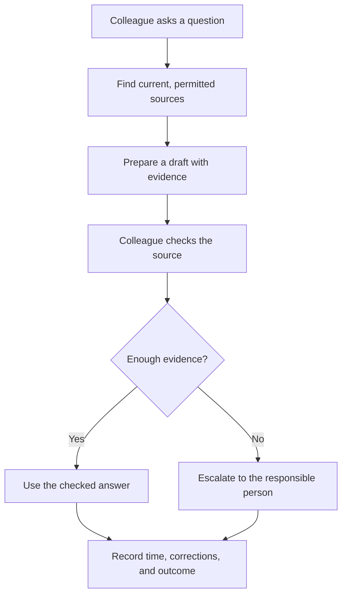

# AI at work: begin with a task people recognise

[Learning hub](../README.md) · [AI explained](ai-primer.md) · [Learning paths](learning-paths.md)

You do not need to train a model to identify a useful AI opportunity. Begin with a task that costs time, loses information, or creates avoidable rework. Describe the input, the desired result, and the person responsible for checking it.

The examples below are **proposed learning and pilot scenarios**, not claims of measured industry results. A similar tool can have very different consequences in different settings.

## One workflow, made concrete

Consider a colleague looking for the correct procedure in a large document collection.



The potential benefit is less searching and repeated drafting. The useful result is a **checked answer**, so measure the entire process. A fast draft that takes longer to correct has not saved time.

## Use cases across fields

| Field | A bounded starting task | What AI could contribute | What a person verifies | Measure in a pilot |
| --- | --- | --- | --- | --- |
| Banking | Find a current product policy | Retrieve passages and prepare a sourced reply | Product, effective date, applicability | Time to a correct answer; wrong-version errors |
| Insurance | Prepare a claim document checklist | Extract fields and flag missing attachments | Evidence and exceptions; claim decisions stay with the authorised process | Missed documents; extraction errors; review time |
| Healthcare | Find an approved administrative procedure | Search a permissioned procedure collection | Correct document and local process; exclude diagnosis from this pilot | Lookup time; incorrect or outdated references |
| Retail & commerce | Draft product support answers | Use catalog facts and return instructions | Product variant, stock or policy freshness, promises made | Corrections; repeat contacts; completed-task time |
| Manufacturing | Help review equipment images | Flag areas that resemble known defects | Image quality and actual defect status | Missed defects; false alarms; time per inspection |
| Education & training | Draft practice questions | Generate questions tied to a supplied lesson | Answer correctness, level, accessibility | Useful questions per review hour; learner confusion |
| Public services | Help residents find a form | Match a described need to approved guidance | Eligibility details and escalation; no automated entitlement decision | Correct routing; abandoned requests; source accuracy |
| Professional services | Compare document versions | Highlight changes and draft a summary | Material omissions and interpretation | Missed changes; review time; corrections |
| Technology & IT | Prepare a support triage recommendation | Suggest category and missing details | Urgency, ownership, and sensitive information | First-route accuracy; missed urgent tickets |
| Logistics & transport | Flag shipments at risk of delay | Estimate risk from tracking events | Conditions and the proposed recovery action | Warning lead time; false alarms; missed delays |
| Energy & utilities | Find an asset's approved field manual | Retrieve the right asset and revision | Asset identity and authorised procedure | Search time; wrong-revision incidents |
| Agriculture & food | Organise crop inspection images | Group images and flag unusual appearances | Local conditions and specialist interpretation | Useful flags; missed issues; review effort |

The portal contains [12 industry guides and their use cases](../src/data/work/industries.ts). Read their inputs, system connections, pilot boundaries, and stop conditions when planning a deeper exercise.

## Same technique, different requirements

Document retrieval can support a retail return question, a bank policy lookup, or an equipment manual search. The software pattern is similar. The evidence requirements are not identical.

| Question to settle | Why it changes the design |
| --- | --- |
| Who is allowed to see the source? | Retrieval must enforce access before passing material to a model |
| Which version applies? | A convincing answer from an expired source can still be wrong |
| What happens after the answer? | A draft for review and an instruction that triggers an action need different controls |
| What is the cost of an error? | The acceptable review burden and escalation threshold depend on the task |
| Who keeps it current? | A pilot needs an owner for both source changes and user feedback |

These are workflow questions to resolve with the relevant domain owners. They are not a substitute for a field's professional standards.

## What each role contributes

| Role | Main question | Useful deliverable |
| --- | --- | --- |
| Leadership | Is this problem worth solving? | A decision brief: benefit, owner, budget, evidence, and stopping criteria |
| Managers | How will the team use it? | A workflow with training, review time, and escalation |
| Team members | Does this help my actual task? | Checked examples and a log of useful, wrong, and missing results |
| Architects | What systems and permissions are involved? | A diagram of sources, boundaries, services, and destinations |
| Delivery teams | What is the smallest useful release? | A pilot backlog and acceptance examples |
| Risk & compliance | Who could be affected, and how? | A task-specific assessment and documented review requirements |
| Operations & support | Who keeps it useful? | A source-update and incident runbook |

These roles also appear in the portal's [role guide](../src/data/work/roles.ts).

## Design a pilot you can learn from

1. **Name the task.** “Help six support agents locate the current installation procedure” is easier to test than “transform support with AI.”
2. **Establish a baseline.** Use representative examples and record the current result, time, corrections, and escalations.
3. **Define success before the trial.** Choose a useful quality measure and a workflow measure. Include unacceptable failures.
4. **Run a bounded comparison.** Keep the task and evaluation rubric comparable. Record when the tool is unavailable or a question has no answer.
5. **Review the evidence.** Separate faster drafts from faster completed work. Inspect results by task type and affected group.
6. **Decide the next step.** Improve the sources, change the design, expand carefully, or stop. A negative result can save a larger investment.

### A fictional calculation

A team handles 40 policy questions per day. Its current median lookup-and-reply time is 8 minutes. In a trial, drafting takes 2 minutes and review takes 3 minutes.

```text
Illustrative saving per question = 8 − (2 + 3) = 3 minutes
Illustrative daily saving = 40 × 3 = 120 minutes
```

This arithmetic is a planning illustration. Actual savings require measured end-to-end task times; subtracting medians of separate stages does not necessarily equal the median saving. Include setup, training, maintenance, unsuccessful requests, and service cost before making an investment claim.

<details>
<summary>Check yourself: the draft is twice as fast, but corrections take longer. Is the pilot successful?</summary>

Not on speed alone. Compare complete task time and output quality with the baseline. More corrections may erase the saving or make the result less dependable. Investigate which task types caused the problem before expanding.
</details>

## Copy this pilot brief

```text
Task and users:
Current process and baseline:
Inputs and approved sources:
AI contribution:
Human review and decision owner:
Success measures:
Unacceptable failures:
Pilot size and duration:
Source-update and support owner:
Decision after the pilot:
```

**Next:** use the [document assistant](projects/document-assistant.md) or [support triage](projects/support-triage.md) design to turn the brief into a technical conversation.
