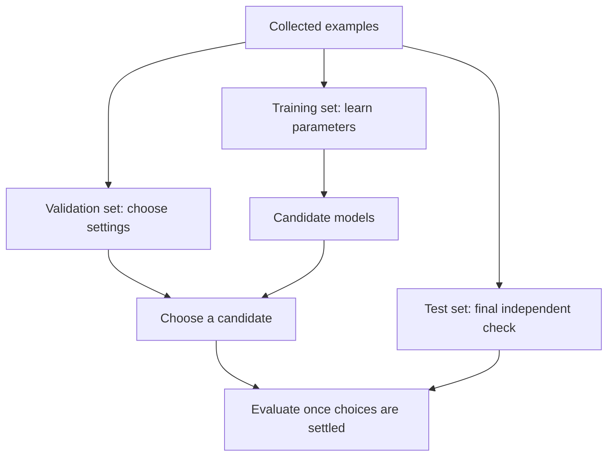
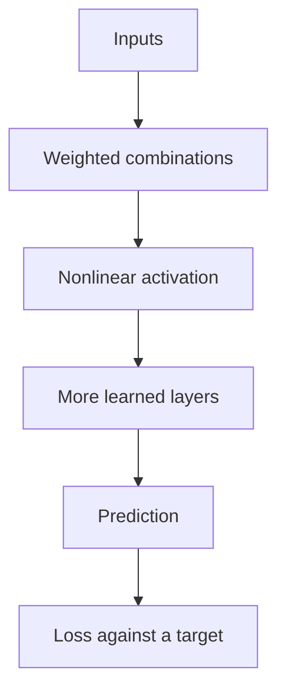
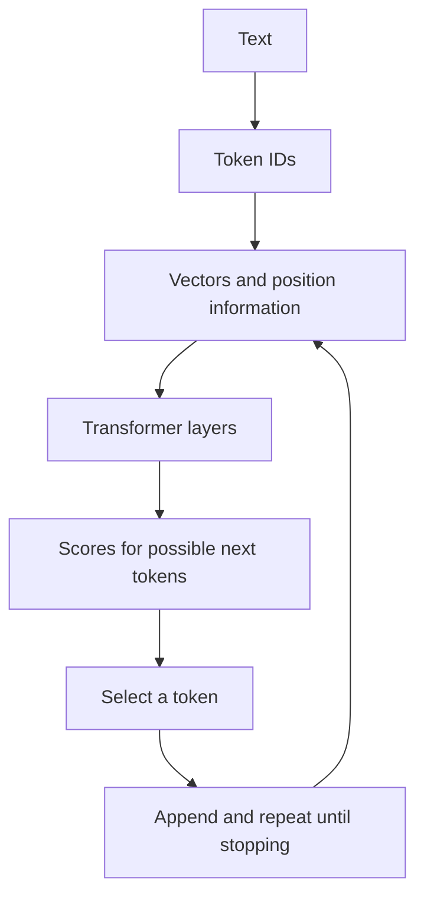
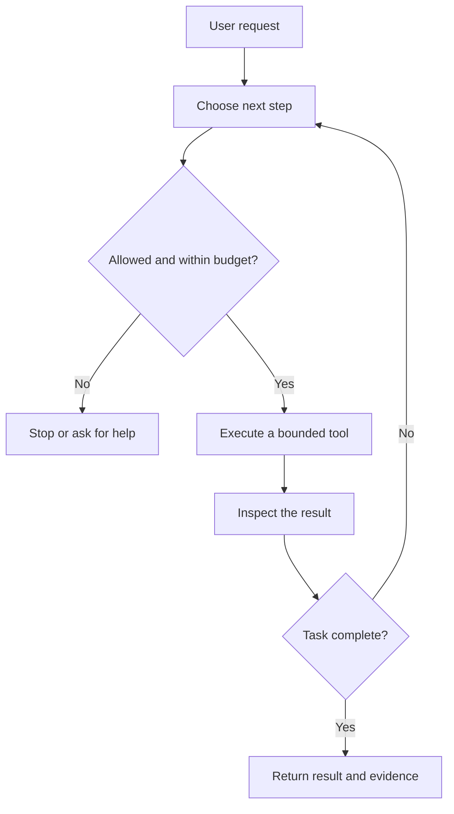

# AI explained through useful questions

[Learning hub](../README.md) · [Learning paths](learning-paths.md) · [Review questions](review-questions.md)

Imagine a service team that receives hundreds of questions every day. Some need a policy lookup, some need a draft reply, and some need a person's judgement. We will use that situation to connect the ideas below.

## On this page

- [What AI actually does](#what-ai-actually-does)
- [Data, features, and labels](#data-features-and-labels)
- [Training and evaluation](#training-and-evaluation)
- [Learning from error](#learning-from-error)
- [Neural networks](#neural-networks)
- [Tokens and attention](#tokens-and-attention)
- [Prompting, retrieval, and fine-tuning](#prompting-retrieval-and-fine-tuning)
- [Tools and agents](#tools-and-agents)
- [From a model to a useful service](#from-a-model-to-a-useful-service)

## What AI actually does

AI is a broad collection of methods for tasks such as recognising patterns, planning actions, and producing text or images. Machine learning is one approach: a program adjusts its parameters using examples. Generative AI produces new outputs based on learned patterns and the input it receives.

A **model** is the part that turns an input into an output. An **application** surrounds it with documents, permissions, interfaces, checks, and a workflow.

| Task | A reasonable starting approach | Example output |
| --- | --- | --- |
| Apply a fixed deadline | An explicit rule | “This request arrived after the closing date.” |
| Estimate whether a ticket is urgent | A classifier trained on labelled examples | An urgency score |
| Find the password reset instructions | Search | A relevant document passage |
| Draft a reply using that passage | A language model with the passage in context | A suggested reply |
| Decide whether an exception is justified | An accountable decision process | A recorded decision with reasons |

AI may support a decision without owning it. Begin by asking whether a rule, a search box, or a better form solves the problem. Add a model when there is a pattern to learn or content to generate, and a way to assess the result.

<details>
<summary>Check yourself: does fluent text prove that an answer is correct?</summary>

No. Fluency describes how the answer reads. Correctness requires checking its claims against evidence. A model can generate a convincing explanation of something that never happened.
</details>

## Data, features, and labels

Suppose you want to predict whether a support request needs urgent attention.

| Ticket | Information available on arrival | Label added after review |
| --- | --- | --- |
| A | “Every user is locked out”; service = payroll | Urgent |
| B | “Please change the report colour”; service = analytics | Routine |
| C | “Payments fail for all customers”; service = checkout | Urgent |

The available inputs are **features**. The outcome used for supervised learning is a **label**. A model learns a relationship between them, rather than being given every possible sentence as a rule.

A subtle mistake is including “time to resolution” as an input when predicting urgency on arrival. That value only exists later. It leaks information from the future and can make an evaluation look unrealistically good.

Useful data work includes checking missing values, duplicates, dates, permissions, and how labels were decided. If reviewers disagree about “urgent,” clarify the definition before expecting a model to learn it.

**Try it:** list three features available when your task begins. Cross out anything created after the decision.

## Training and evaluation

Training adjusts the model using examples. Evaluation asks how it performs on examples that did not guide those adjustments.



Do not repeatedly tune a system against the same “final” test. That gradually turns the test into another development set. Keep duplicate or related records together when a random split would leak information. For a forecast, train on the past and evaluate on a later period.

Fit learned preprocessing, such as a scaler, on the training portion only. Apply that fitted transformation to held-out examples. The [scikit-learn cross-validation guide](https://scikit-learn.org/stable/modules/cross_validation.html) explains how holdouts and repeated splits support evaluation.

**Choose a meaningful comparison.** If 95 of 100 tickets are routine, a system that always says “routine” gets 95% accuracy while missing every urgent ticket. Compare with the current process and inspect the important error types.

<details>
<summary>Check yourself: why can a model do well in training and poorly on new examples?</summary>

It may have memorised details that do not generalise. It may also face different users, language, or conditions after release. Check both overfitting and differences between the training and deployment data.
</details>

## Learning from error

Start with a tiny model: `prediction = weight × input + bias`. The weight controls the slope of a line; the bias shifts it up or down.

For a made-up relationship `y = 2x + 1`, an input of 3 has a target of 7. If the model uses weight 1 and bias 0, it predicts 3. Its error is `3 − 7 = −4`; its squared error is `16`.

**Loss** summarises errors across examples. **Gradient descent** changes parameters in a direction that locally reduces that loss:

```text
new parameter = old parameter − learning rate × loss gradient
```

For that single example, the squared-error gradient with respect to weight is `2 × (3 − 7) × 3 = −24`. With a learning rate of 0.01, the weight changes from 1 to 1.24. The bias gradient is `2 × (3 − 7) = −8`, so the bias changes from 0 to 0.08. The next prediction becomes 3.8, closer to 7.

Real training usually combines many examples. A step that is too large can overshoot; a very small step may learn slowly. A lower training loss also does not guarantee better performance on new data.

Run [linear_regression.py](../examples/linear_regression.py) to watch both parameters move. Then change the learning rate and compare the loss. [Google's linear regression lesson](https://developers.google.com/machine-learning/crash-course/linear-regression) offers a deeper explanation.

## Neural networks

A linear model has a limited shape. A neural network combines layers of learned transformations with nonlinear functions, allowing more complex relationships.



During training, **backpropagation** computes how each parameter contributes to the loss using the chain rule. An optimiser uses those gradients to update the parameters. During **inference**, the system uses the learned parameters to produce an output; it does not ordinarily retrain itself on every request.

More layers and parameters do not automatically solve a task. Data quality, the objective, compute, and evaluation still matter. Follow [PyTorch's basics tutorial](https://docs.pytorch.org/tutorials/beginner/basics/intro.html) when you are ready to implement the training loop.

## Tokens and attention

A language model does not directly operate on whole sentences as a person reads them. A **tokenizer** maps text to a sequence of token IDs. Tokens may represent a word, part of a word, punctuation, or other units; the split depends on the tokenizer.

An **embedding** maps an ID to a vector of numbers. Within a transformer, attention allows a position to combine information from positions it is allowed to attend to. Different layers and attention heads learn different transformations; attention weights alone are not a complete explanation of the model's reasoning.



This is a simplified decoder language-model loop. A training run teaches statistical relationships; a generation run conditions on the prompt and generated tokens. Output length, sampling settings, and stopping rules affect the result.

The original [Attention Is All You Need paper](https://arxiv.org/abs/1706.03762) introduced the transformer for sequence transduction. The [Hugging Face LLM Course](https://huggingface.co/learn/llm-course/chapter1/1) connects these concepts to tools and exercises.

<details>
<summary>Check yourself: is an embedding a database record of verified facts?</summary>

No. It is a numerical representation learned for an objective. Similarity can help find related material, but a nearby vector does not establish truth, permission, or relevance to every question.
</details>

## Prompting, retrieval, and fine-tuning

These approaches solve different problems and can be combined.

| Approach | What changes | Useful when | What it does not guarantee |
| --- | --- | --- | --- |
| Prompting | Instructions, examples, or context supplied to the model | The model needs a clearer task or output format | Correct facts or consistent behaviour |
| Retrieval-augmented generation (RAG) | Relevant source passages are found and added to the request | Answers depend on a changing document collection | That retrieval finds the right passage or generation follows it |
| Fine-tuning | Some or all model parameters | Repeated task behaviour needs adaptation using suitable examples | A live, authoritative copy of changing facts |

For a policy assistant, start with an approved source collection and a retrieval baseline. Require an answer to point to supporting passages, and allow “I do not have enough evidence.” A document can contain misleading instructions, so retrieved text must be handled as data rather than permission to act.

The [RAG paper by Lewis and colleagues](https://arxiv.org/abs/2005.11401) combines parametric and retrieved information for language generation. Our [document assistant project](projects/document-assistant.md) uses a simple modern application design to explore the surrounding workflow.

## Tools and agents

A model can suggest a tool call, such as searching a catalog or reading a ticket. The application must validate and execute it. An **agent loop** lets the system observe a result and decide what to do next.



Keep tool permissions outside the model. A system that can search documents does not automatically need permission to edit them, send messages, or move money. Set request budgets, timeouts, maximum steps, and a review point for consequential actions.

**Try it:** draw the loop for looking up an order. Mark what the assistant can read, what it can change, and what ends the loop.

## From a model to a useful service

A useful service has four connected questions:

1. **Quality:** does the output help with the task, including unusual cases?
2. **Workflow:** who checks it, acts on it, and handles uncertainty?
3. **Operation:** does it respond within the time and resource budget?
4. **Change:** how will you detect stale sources, broken dependencies, or declining performance?

Record the input, system version, evidence, outcome, and review result where appropriate for the data involved. Start with a comparison against the existing process, then look at total effort including corrections.

**Next:** choose a use case in [AI at work](ai-at-work.md), design a [document assistant](projects/document-assistant.md), or explore the [infrastructure guide](infrastructure.md).
