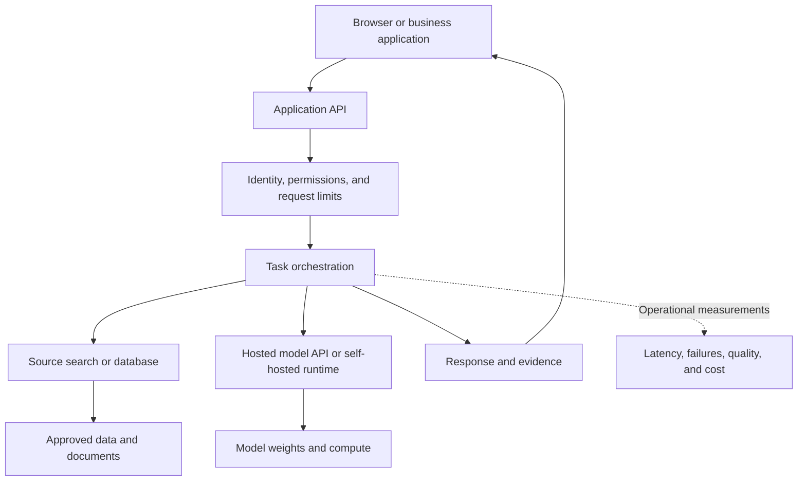

# AI infrastructure: what runs where, and why

[Learning hub](../README.md) · [Systems learning path](learning-paths.md#systems-path) · [Resource guide](resources.md)

Start with the workload: what inputs arrive, what outputs are needed, how quickly, and how often? Hardware follows those requirements.

## What system do you need to learn?

| Activity | Starting setup | What increases the requirement |
| --- | --- | --- |
| Read this hub and run its Python examples | A computer with a browser and Python 3.10+ | The examples need no GPU or network calls |
| Run the ilearnai portal locally | Node.js and npm; see [development setup](development.md) | Build assets, browser capabilities, and external media downloads |
| Train small tabular models | A CPU environment with appropriate libraries | Dataset size and repeated experiments |
| Experiment with a local language model | A runtime compatible with the model and your hardware | Model weights, context length, precision, and acceptable latency |
| Fine-tune a model | A training stack and a measured memory budget | Gradients, optimiser state, activations, and batch size |
| Serve many users | A measured service design with monitoring | Concurrency, output length, traffic bursts, and availability requirements |

There is no single RAM or GPU specification for “AI.” Choose a small representative experiment and measure it before buying or reserving hardware.

## The parts of an AI application



Storage holds documents, metadata, datasets, and model artifacts. Search finds relevant material. The application owns permissions and workflow. The model runtime performs inference. Monitoring connects resource use to user outcomes.

You may need only a few of these components initially. A service does not become more useful simply by adding a vector database, a queue, or an agent framework.

## Hosted or self-hosted?

| Choice | What it simplifies | What you still own |
| --- | --- | --- |
| Hosted model API | Obtaining and operating model-serving capacity | Data handling, application quality, rate limits, failures, and usage cost |
| Self-hosted runtime | Direct control over model/runtime configuration and deployment location | Capacity, updates, hardware compatibility, monitoring, and model terms |
| Local learning experiment | A small reproducible environment under your control | Installation, performance limits, and checking results |

[llama.cpp](https://github.com/ggml-org/llama.cpp) provides local inference tooling across supported hardware. [vLLM](https://docs.vllm.ai/en/latest/) provides model-serving tooling. Check each project's current model and hardware support rather than assuming every configuration works.

## Worked capacity estimate

The following numbers are invented planning inputs. They are not a hardware benchmark.

### 1. Estimate weight storage

For a dense model with 7 billion stored parameters:

```text
Raw weight bytes = parameter count × bits per parameter / 8

16-bit weights: 7,000,000,000 × 16 / 8 = 14,000,000,000 bytes ≈ 13.04 GiB
 4-bit weights: 7,000,000,000 ×  4 / 8 =  3,500,000,000 bytes ≈  3.26 GiB
```

These are weight-storage estimates only. Quantisation metadata, runtime workspaces, activations, and caches need additional memory. Quantised storage also does not mean all computation occurs at that bit width.

### 2. Estimate a KV cache

Autoregressive transformers can cache attention keys and values from prior tokens to avoid recomputing them. The cache consumes memory as the retained context grows. The [Transformers cache guide](https://huggingface.co/docs/transformers/kv_cache) explains implementation choices and their trade-offs.

For a simplified full-attention cache with equal shapes in every layer:

```text
Cache bytes = 2 × layers × tokens × KV heads × head dimension × bytes per value

Example per sequence:
2 × 32 × 4,096 × 8 × 128 × 2 = 1,073,741,824 bytes = 1 GiB
```

The factor 2 represents keys and values. Use the **KV head count**, which may differ from the query-head count. This estimate excludes allocator overhead and assumes no cache sharing, sliding-window reduction, offloading, or quantisation. Architectures with different cache structures need a different calculation.

### 3. Estimate requests in flight

Suppose a stable system receives 3 requests per second and the mean end-to-end time is 8 seconds:

```text
Average requests in flight ≈ arrival rate × mean time
                           = 3 × 8 = 24
```

This is Little's law applied to the whole request system. It includes waiting if the measured time includes waiting. It does not mean exactly 24 requests are simultaneously decoding, or that each one occupies a full 4,096-token cache. Use average time here, not a p95 value.

### 4. Load-test the actual design

Run representative input and output lengths, including bursts. Measure time to first token, generation rate, end-to-end latency, queue time, memory, failures, and completed-task cost.

A model fitting into memory does not establish adequate throughput. Batching may improve total throughput while changing individual latency. Set request limits and timeouts from measurements, then rerun the same workload after changing the model or runtime.

<details>
<summary>Check yourself: a 4-bit model's raw weights fit in memory. Is that enough to promise it will run well?</summary>

No. The runtime may need extra memory for quantisation metadata, caches, activations, and temporary buffers. Performance also depends on hardware support and the workload. Measure the real model and runtime together.
</details>

## From experiment to operation

| Concern | Decide before expanding |
| --- | --- |
| Source changes | Who updates the index and verifies new versions? |
| Access | Where is identity enforced, including caches and retrieved passages? |
| Load | How are requests limited, queued, or rejected when capacity is exhausted? |
| Failure | What does the user see if search or inference is unavailable? |
| Release | Which evaluation set and workload must pass before a new version ships? |
| Recovery | How can the team return to the previous model, prompt, index, or workflow? |

**Next:** follow [System Design](learning-paths.md#system-design) for reliability and storage, or [Inference Engineering](learning-paths.md#inference-engineering) for deeper memory and serving work.
