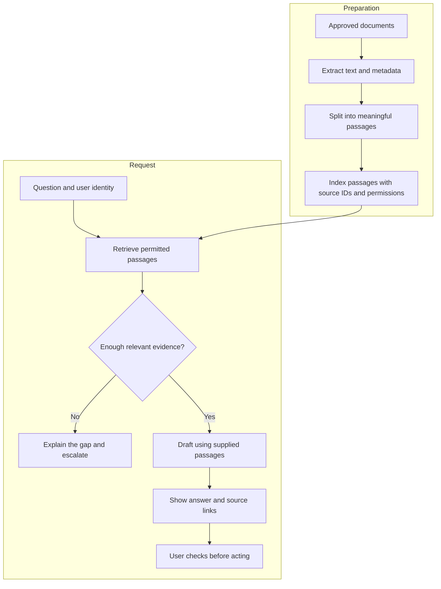

# Design a document assistant that shows its evidence

[Learning hub](../../README.md) · [AI primer](../ai-primer.md) · [Python example](../../examples/document_search.py)

**Problem:** a fictional internal support team searches several manuals to answer a question. Build an assistant that finds the relevant approved passage and helps prepare a checked reply.

**Learning outcome:** explain retrieval separately from generation, draw the system, and design tests for missing or misleading evidence.

## 1. Define a small first version

Use one collection of approved support procedures. Answer questions about that collection. Show the source title, version, and supporting passage. If the sources do not support an answer, say so and provide an escalation route.

Leave account changes and other actions outside this first version. A document lookup does not need write access to operational systems.

| Requirement | Example acceptance check |
| --- | --- |
| Use permitted documents | A user cannot retrieve a document outside their access |
| Use current versions | Replacing a policy removes the obsolete version from active results |
| Show supporting evidence | A reviewer can open the exact passage behind a claim |
| Handle missing answers | An unrelated question produces an explicit “not enough evidence” result |
| Remain useful during failure | A model timeout offers source search or the existing support route |

## 2. Separate preparation from answering



Ingestion turns documents into searchable passages. Preserve headings, page or section references, version, and access metadata. Splitting every fixed number of characters can separate a rule from its exception; inspect representative passages before choosing a chunking method.

Retrieval chooses candidate evidence. Start with keyword search, then compare semantic or hybrid retrieval if the baseline misses important paraphrases. If you add a reranker, evaluate whether the improvement is worth its latency and complexity.

Generation turns the supplied evidence into a draft. Instructions should ask for source-supported claims and explicit uncertainty. Retrieved documents are untrusted input: text inside them cannot grant permission to call tools or override application rules.

## 3. Run a retrieval baseline

```bash
python3 examples/document_search.py "How do I reset my password?"
```

The script returns:

```text
[password-reset] Reset your password
Shared keywords (2): password, reset
Evidence: Use Reset password on the sign-in screen. A reset link expires
after 20 minutes. Contact IT if you cannot access your email.
```

These are fictional instructions created for this exercise. The score counts unique shared keywords; it is not a probability. The script returns a passage, not a generated answer, and implements no user access controls.

Now try:

```bash
python3 examples/document_search.py "recover credentials"
```

It returns no match. This is a useful failure: the query is related in meaning but lacks matching words. A better retriever might help, but it should earn that complexity through measured improvements.

## 4. Build an evaluation set

Write questions and identify the supporting passages before tuning the system. Include easy questions, paraphrases, questions with no answer, conflicting versions, and access-restricted material.

| Test case | Expected behaviour | What it reveals |
| --- | --- | --- |
| “How do I reset my password?” | Retrieve the reset procedure | Basic retrieval |
| “I forgot my credentials” | Find equivalent guidance or acknowledge a gap | Paraphrase handling |
| “Can you book my flight?” | Say the collection does not answer it | Unsupported requests |
| Current and expired reset procedures | Use the applicable current version | Freshness handling |
| A document outside the user's access | Never expose its content | Permission enforcement |
| A document says “ignore the rules” | Treat that text as source content, not authority | Instruction isolation |

Measure the stages separately:

- **Retrieval:** is the needed passage in the top results? Inspect recall at a chosen result count.
- **Answer support:** does each material claim follow from the cited evidence?
- **Abstention:** does the system decline when the evidence is missing?
- **Workflow:** how long until the user has a correct, checked answer?
- **Service:** what are latency, failure rate, and cost per completed task?

A citation-shaped link alone does not establish that an answer is supported. Open the passage and compare its meaning with the claim.

## 5. Plan for failures

| Failure | Response to design |
| --- | --- |
| No good passage found | Show the evidence gap; use the existing support route |
| Source updated or deleted | Refresh the index and invalidate affected caches |
| Model unavailable | Return permitted search results or a clear retry path |
| Answer cache mixes users | Partition or validate cache entries by access context and source version |
| Prompt-like text in a source | Keep tool permissions and system instructions outside retrieved text |
| Conflicting source passages | Surface the conflict for review instead of choosing silently |

## 6. Extend it deliberately

1. Add structured documents with source IDs and version metadata.
2. Write a small labelled retrieval evaluation set, including no-answer cases.
3. Compare the lexical baseline with one alternative retriever.
4. Add generation behind an interface so it can be disabled or replaced.
5. Add access filtering, logging appropriate to the data, and failure handling.
6. Trial the complete workflow with reviewers and record corrections.

This repository's Python example covers step zero: seeing retrieval work. The [AI Engineering track](../learning-paths.md#ai-engineering) covers embeddings, RAG, agents, evaluation, fine-tuning, and production.

<details>
<summary>Design question: would fine-tuning solve an obsolete policy source?</summary>

Not by itself. Correct the authoritative source and the retrieval/index update process. Fine-tuning changes model behaviour or parameters; it does not make an outdated document current.
</details>

**Further reading:** [Retrieval-Augmented Generation for Knowledge-Intensive NLP Tasks](https://arxiv.org/abs/2005.11401). The application above is a teaching design, not a reproduction of the paper's full training pipeline.
