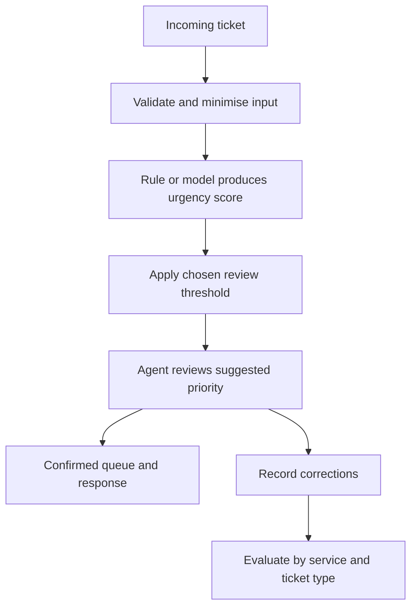

# Design support triage around the errors that matter

[Learning hub](../../README.md) · [AI at work](../ai-at-work.md) · [Python example](../../examples/evaluate_triage.py)

**Problem:** a fictional service desk wants to identify urgent requests sooner. The assistant recommends a review priority; a service agent confirms it.

**Learning outcome:** compare a baseline, read a confusion matrix, and explain why a threshold must reflect the task.

## 1. Define urgent before building

“Urgent” needs a consistent, operational meaning. For this exercise, use a service interruption affecting active users. Have reviewers label representative past tickets using the same rubric and resolve disagreements.

Use only information available when a new ticket arrives. A final resolution category, later escalation, or response time can leak the outcome.

Begin with a baseline such as the existing routing rules. If a small keyword rule performs well enough, record that result before introducing a more complex model.

## 2. Design the workflow



The recommendation must not quietly remove a request from the normal review process. In a first pilot, run in shadow mode: compare suggestions with actual outcomes without changing live routing.

## 3. Understand the four outcomes

| | Actually urgent | Actually routine |
| --- | --- | --- |
| Flagged urgent | **True positive (TP):** useful alert | **False positive (FP):** unnecessary urgent review |
| Not flagged | **False negative (FN):** missed urgent request | **True negative (TN):** correctly left routine |

```text
Precision = TP / (TP + FP)     Of the flags, how many were useful?
Recall    = TP / (TP + FN)     Of the urgent cases, how many were caught?
Accuracy  = (TP + TN) / all   Of all decisions, how many were correct?
```

If nothing is flagged, precision has a zero denominator and is undefined. A dashboard should explain that state rather than implying perfect precision. See [scikit-learn's evaluation guide](https://scikit-learn.org/stable/modules/model_evaluation.html) for these metrics and their conventions.

## 4. Compare two thresholds

```bash
python3 examples/evaluate_triage.py
```

The script uses 12 invented tickets with 6 urgent labels and hand-authored scores. A score at or above the threshold is flagged.

| Threshold | TP | FP | FN | TN | Precision | Recall | Accuracy |
| --- | --- | --- | --- | --- | --- | --- | --- |
| 0.50 | 5 | 2 | 1 | 4 | 71.4% | 83.3% | 75.0% |
| 0.80 | 3 | 0 | 3 | 6 | 100.0% | 50.0% | 75.0% |

Both settings have the same accuracy. The higher threshold removes false alarms in this sample but misses half the urgent tickets. This is why “make the score higher” is not enough to choose a useful setting.

For an illustrative error cost, count a missed urgent ticket as 10 units and a false alarm as 1:

```text
Threshold 0.50: 10 × 1 missed + 2 false alarms = 12 units
Threshold 0.80: 10 × 3 missed + 0 false alarms = 30 units
```

Those units are a teaching assumption, not monetary costs or a recommendation for a live service. Real costs include review capacity, delay, and the effect on users.

## 5. Move from illustration to evidence

The example does not train a classifier. A real experiment needs a representative dataset, a suitable baseline, and separate development and test data.

| Stage | Work to do |
| --- | --- |
| Dataset | Define labels; remove duplicates; identify related tickets and time periods |
| Development | Train a baseline; choose features; tune thresholds on validation data |
| Independent test | Measure once choices are settled; inspect uncertainty and error examples |
| Shadow pilot | Compare with the current workflow without changing decisions |
| Limited rollout | Keep review and escalation; monitor changes in language and ticket mix |

Inspect results by service, language, severity, and relevant user groups. A good average can conceal a weak result for a critical task. Small samples also produce unstable percentages; report the counts behind the rates.

<details>
<summary>Design question: why not flag every ticket as urgent?</summary>

That catches every urgent ticket in a fully labelled batch, but also sends every routine ticket into urgent review. If the queue becomes overwhelmed, the system may fail to help the people it was meant to prioritise. Evaluate the whole workflow, including review capacity and delay.
</details>

**Next:** change the example threshold, explain the new confusion matrix, and write a pilot brief using [AI at work](../ai-at-work.md#copy-this-pilot-brief).
